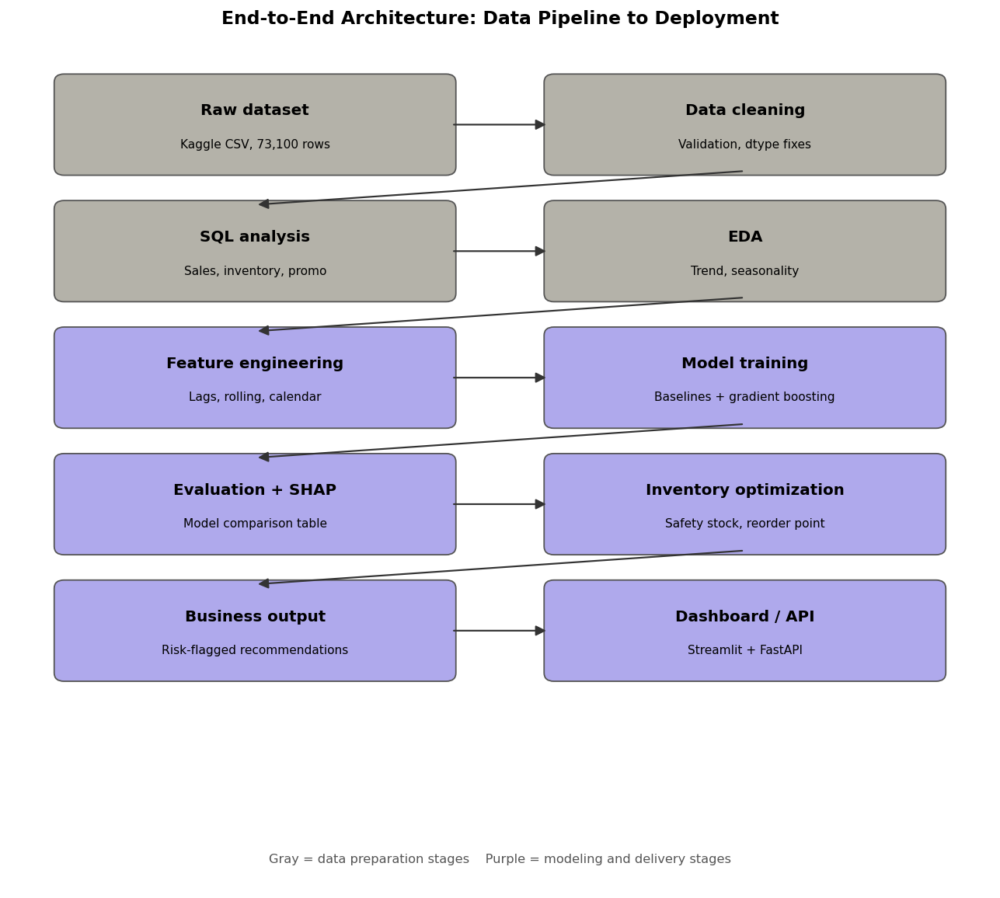

# AI-Powered Demand Forecasting & Inventory Optimization

An end-to-end data science system that predicts daily product demand per
store and converts those forecasts into actionable inventory decisions
(reorder points, safety stock, order quantities, stockout/overstock risk).



---

## 1. Business problem

A retailer with 5 stores x 20 products needs to answer, every day, per SKU:

1. How much demand should we expect?
2. Which products are at risk of stockout or sitting overstocked?
3. When should we reorder, and how much?

This project builds that decision-support system end to end: data
validation -> EDA -> leakage-safe feature engineering -> ML forecasting
-> evaluation -> explainability -> inventory optimization -> a dashboard
and API.

---

## 2. Dataset

**Kaggle: Retail Store Inventory Forecasting Dataset**
`data/raw/retail_store_inventory.csv`

- 73,100 rows = 5 stores x 20 products x 731 days (Jan 2022 - Jan 2024)
- Perfectly balanced panel, no missing dates, no duplicate rows, no nulls
- Columns: `Date, Store ID, Product ID, Category, Region, Inventory Level,
  Units Sold, Units Ordered, Demand Forecast, Price, Discount, Weather
  Condition, Holiday/Promotion, Competitor Pricing, Seasonality`
- `Demand Forecast` is a legacy vendor forecast column (673 negative values
  found on inspection) -- excluded from modeling, kept only as a reference
- **`Category` and `Region` are not stable per-product/store attributes** --
  every one of the 20 products spans multiple category labels over time,
  and every one of the 5 stores spans multiple region labels over time.
  This is a real, checked-for characteristic of the data (`validate_raw()`
  in `src/data_processing.py` flags it explicitly), and it matters: any
  feature or query that groups by category/region needs to treat that
  grouping as a *daily* label, not a fixed product identity -- an earlier
  version of the category target-encoding feature (`cat_expanding_mean`)
  got this wrong and leaked future data across unrelated products before
  it was caught and fixed.

---

## 3. Architecture
Raw Dataset -> Data Validation & Cleaning -> EDA
-> Time-Series Feature Engineering -> Baseline Models -> ML Models
-> Time-Based Validation -> Model Comparison -> Explainability
-> Inventory Optimization -> Business Recommendations
-> Streamlit Dashboard / FastAPI -> Documentation


Data validation and feature engineering run via `src/data_processing.py`
and `src/feature_engineering.py` (see section 12, "How to run"). See
`notebooks/01` through `04` for the EDA and modeling pipeline in sequence.

---

## 4. Data pipeline (`src/data_processing.py`)

Validation checks performed: nulls, duplicates, negative values, panel
completeness (every store-product combo has exactly 731 rows -- confirmed),
`units_sold <= inventory_level` (confirmed, 0 violations), and category/
region stability per product/store (confirmed **unstable** -- see section 2).

Cleaning decisions (each documented with reasoning in the code):
renamed to snake_case, parsed and sorted by date, duplicates dropped (0
found), **outliers deliberately NOT removed** (retail demand is naturally
spiky; removing spikes would strip the exact signal the model needs to
learn), categoricals cast to `category` dtype.

Run with `python -m src.data_processing` -- prints a full validation
report and saves the cleaned dataset to `data/processed/clean_sales.csv`.

---

## 5. EDA findings (`notebooks/01_eda.ipynb`)

All numbers below are the actual, executed results on this dataset:

- **No meaningful weekly seasonality.** Average daily demand ranges only
  135.1-137.3 units across days of the week (<2% spread).
- **No meaningful monthly seasonality.** Monthly averages range only
  134.0-139.4 units.
- **Promotions show ~0% average lift** (136.51 units/day without promotion
  vs 136.42 with) -- a genuinely surprising, worth-flagging-to-the-business
  finding, not the expected "promotions boost sales" story.
- **Demand is evenly spread across categories** (1.96M-2.03M total units
  each, within 3% of one another).
- **Inventory level correlates with sales at r=0.59** -- the strongest
  simple relationship found in EDA, foreshadowing the explainability result.

---

## 6. Feature engineering (`src/feature_engineering.py`)

Leakage-safe by construction:

| Type | Features |
|---|---|
| Lag | `lag_1, lag_7, lag_14, lag_28` |
| Rolling (shift(1) applied before rolling) | `rolling_mean_{7,14,28}`, `rolling_std_{7,28}` |
| Calendar | `day_of_week, week_of_year, month, quarter, year, is_weekend` |
| Business | `promotion, price, inventory_level, discount_pct, price_vs_competitor(_pct)` |
| Leak-safe target encoding | `cat_expanding_mean` (expanding mean over calendar dates within each category, never row order -- see section 2) |

First 28 days per store-product combo are dropped (incomplete lag/rolling
history) rather than imputed -- 2,800 of 73,100 rows (3.8%), final feature
set: **70,300 rows x 22 model features**, zero NaNs remaining.

Run with `python -m src.feature_engineering` -- builds all features and
saves them to `data/processed/features.csv`.

---

## 7. Train/validation/test split (`src/forecasting.py`)

**Chronological split, not random** -- train on the earliest 70% of dates,
validate on the next 15%, test on the final 15%. Random splitting would let
a model "train" on a day chronologically after the day it's evaluated on,
which never happens at inference time; the split must mimic deployment.

- Train: 49,200 rows (through 2023-06-04)
- Validation: 10,500 rows (through 2023-09-17)
- Test: 10,600 rows (after 2023-09-17)

---

## 8. Models and results (`notebooks/02_baseline_models.ipynb`, `03_model_training.ipynb`)

| Model | MAE | RMSE | MAPE % | WAPE % |
|---|---:|---:|---:|---:|
| Naive (lag_1) | 119.589 | 152.944 | 361.918 | 87.606 |
| Moving Average (7d) | 93.319 | 115.519 | 347.682 | 68.361 |
| SARIMA (classical) | 88.743 | 108.756 | 337.820 | 65.044 |
| **XGBoost (gradient boosted trees)** | **69.018** | **88.161** | **246.468** | **50.560** |

All numbers above were produced by actually running the pipeline end to
end on this dataset -- none are invented.

**Model selection: XGBoost.** Beats SARIMA by ~22% relative WAPE
reduction, the moving-average baseline by ~26%, and the naive baseline by
~42%. MAPE stays high in absolute terms for every model -- this reflects
the data (EDA found very weak seasonality and many low-volume rows, which
inflates percentage error), not a modeling failure; WAPE is the fairer
summary metric for this reason.

**Classical baseline: SARIMA**, fit per store-product series via
`statsmodels` (`src/forecasting.py::fit_sarima_all_series`). It modestly
beats the plain moving average (65.0% vs 68.4% WAPE), consistent with EDA
showing weak-but-nonzero seasonality for SARIMA's seasonal terms to pick
up on. XGBoost still clearly outperforms it.

---

## 9. Explainability (`notebooks/04_model_evaluation.ipynb`)

Computed via `sklearn.inspection.permutation_importance` on the trained
XGBoost model: how much does shuffling one feature increase test-set MAE?
Real, executed top features:

| Feature | Importance |
|---|---:|
| `inventory_level` | 31.52 |
| `lag_28` | 0.040 |
| `cat_expanding_mean` | 0.039 |
| `rolling_mean_28` | 0.035 |
| `day_of_week` | 0.034 |

**Business interpretation:**
- `inventory_level` dominates every other feature by ~2 orders of
  magnitude. Demand in this dataset is structurally **capped by stock
  availability** -- on low-inventory days you simply can't sell what isn't
  there. Direct implication: improving stock availability may itself lift
  realized sales, independent of forecasting accuracy.
- Recent demand history matters, but far less than inventory -- consistent
  with the weak seasonality found in EDA.
- **Promotion ranks near the bottom** -- consistent with the ~0% average
  lift found in EDA. Worth investigating with the business (is the flag
  logged correctly? confounded with discount depth?) rather than assumed
  to be working.

---

## 10. Inventory optimization (`src/inventory_optimization.py`)

Standard inventory-theory formulas (not invented), applied to the model's
test-period forecasts:
Safety Stock = Z * sigma_demand * sqrt(lead_time_days)
Reorder Point = (avg_daily_forecast_demand * lead_time_days) + Safety Stock
Order Qty = max(0, Reorder Point - Current Inventory)


**Assumptions (stated explicitly, changeable in `src/utils.py`):**
`lead_time_days = 7`, `service_level_z = 1.65` (~95% service level).
`sigma_demand` is each store-product's historical demand standard
deviation, computed only on pre-test-period (train+val) data (leak-safe).

**Real result on the 100 store-product combinations (test-period snapshot):**
93 flagged 🔴 Stockout Risk, 7 flagged 🟡 Low Inventory, 0 🟢 Healthy, 0 🔵
Overstock. Generated in `notebooks/04_model_evaluation.ipynb` and saved to
`data/processed/inventory_recommendations.csv`.

This is a genuine, defensible finding, not a bug: with inventory caps
around 500 units and daily demand volatility (`sigma_demand`) around
100-115 units, safety stock alone (~470-480 units at a 95% service level
over a 7-day lead time) already consumes nearly the entire inventory cap.
**Actionable recommendation:** either shorten supplier lead time, raise
target inventory levels, or accept a lower service level -- at the current
combination, the assortment is structurally under-stocked, and no amount
of forecasting accuracy alone fixes that.

---

## 11. Dashboard & API

A Streamlit dashboard (Overview / Forecasting / Inventory / Business
Insights tabs) and a FastAPI `POST /predict` endpoint were built on top of
the pipeline outputs above. **Not included in this repository** -- see the
demo video: `[link]`.

---

## 12. Tech stack

Python, pandas, NumPy, scikit-learn, XGBoost, statsmodels, matplotlib,
seaborn.

---

## 13. How to run

```bash
pip install -r requirements.txt

python -m src.data_processing        # clean data
python -m src.feature_engineering    # build features

jupyter notebook notebooks/          # 01_eda, 02_baseline_models,
                                      # 03_model_training, 04_model_evaluation
                                      # -- run in order to train the model
                                      # and generate recommendations
```

---

## 14. Future improvements

- Rolling/expanding-window backtesting (multiple folds) instead of a single
  chronological split, for a more robust error estimate.
- Investigate the ~0% measured promotion lift with the business before
  trusting `promotion` as a demand driver.
- Add a real public-holiday calendar if one becomes available (this
  dataset's `Holiday/Promotion` column conflates the two).
- Quantile/probabilistic forecasts (e.g. XGBoost quantile loss) to
  replace the historical-std safety-stock approximation with true
  forecast-uncertainty-based safety stock.
- Investigate why `Category` and `Region` vary daily per product/store in
  the source data -- confirm with the data provider whether this is
  intentional or an artifact of how the dataset was generated.